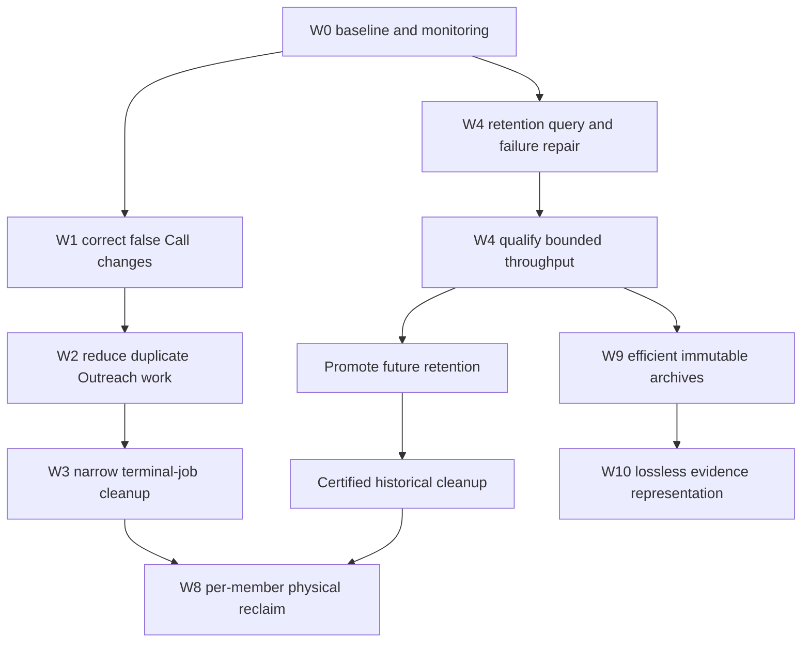

# Capacity implementation and release plan

**Original planning baseline:** November 16, 2026 New York. Scope: main-server behavior and its collection contracts; shared database ownership preserved. Use [SPECIFICATION.md](SPECIFICATION.md) for the measured case and invariants. Current W1 implementation, validation and deployment status is in [PHASE-ONE-RELEASE.md](PHASE-ONE-RELEASE.md). The remaining phases below are plans, not released or qualified behavior.

## Recommended order

W5 automation checkpoint efficiency, W6 Sheets correctness and W7 future RingCentral retention are independent follow-on lanes after the first high-yield release. W9 can run alongside W4; it is a prerequisite only if measured v1 archive cost/load prevents safe relief.

The three-slot cadence stopgap is an **Owner choice**, not the default release. Nominal slot reduction is 18→3 (83.3%); total row, write and disk reductions will differ. Preserve independent discovery, already-approved plans and recovery. Refresh gaps become up to five daytime hours and fourteen overnight hours. A toggle back is the rollback after capacity qualification. No schedule change was made.

## W0 — lock the baseline and make growth visible

**Priority:** immediate, alongside W1. **Owner:** main-server + Admin/operations.

1. Attest deployed SHA and runtime configuration. Record the live database, cluster, tier, configured disk, cutoff and current retention mode. Keep credentials in local runtime only.
2. Reuse this packet's raw-driver measurement scripts; they do not bootstrap models or create indexes. Bound every production query. Replace the timed-out whole-collection cutoff census with checkpointed indexed ID windows and separate Date/policy classification; sum only fully completed partitions.
3. Add bounded per-workflow counters for capture rows/bytes, business-change outcomes, work nominations/claims/completions, archive I/O and eligible/stamped/removed retention progress. Define interval and unique-vs-repeat semantics.
4. Change Systems forecasts to recent and long-window measurements with resize/compaction segmentation; replace false oplog reclaim arithmetic with measured/estimated/unknown fields. Inspect Admin consumers before changing API types.
5. Configure early worst-member disk alerts and application growth/backlog alerting after validation. Existing 90% and auto-scale alerts remain.

**Proof:** saved baselines at matching timestamps; offline forecasting tests cover fewer than seven points, rapid growth change, missing/stale metrics, a compact step, disk resize, flat files with internal reuse and member divergence. Alerts are tested with synthetic metrics/test routing, not real customer messages. No secret/token/customer payload in metrics.

**Rollback:** restore prior dashboard contract if needed while retaining measurements; disable new alert/config revision. No data removal.

## W1 — fix equal-date Call snapshots

**Priority:** first code release. **Owner:** main-server Granot/domain commands. **Dependency:** no new schema or audit-policy decision.

**Implementation:**

- Include canonical `move_date` in the Call `loadGranotLeadProjection` result and assert projection parity against every field the desired-state planner consumes.
- Add a command-layer actual-diff guard so equal planned values cannot independently request Sheet Sync or business-change facts. Preserve the existing separate temporal winner acceptance path.
- Scope that guard to equal-date-only work with an already-current exact Record Link. Preserve legitimate linking, other canonical changes and sibling repairs. When the actual semantic diff is empty, canonically replan or commit transactional `already_current` acceptance with its correct Decision; do not keep a false applied outcome or skip acceptance. Include a concurrent writer making the date equal after planning in the regression suite.
- Verify Form/Call sibling projections and all creation/qualification fences; do not broaden Call creation.
- Add bounded before/after metric for provenance-only applied outcomes and downstream nominations.

**Proof before release:** pure planner regression plus an isolated-replica processor/command test with a stored equal date, two fresh captures, same-operation replay, a delayed older changed date, a newer real changed date, timezone/date normalization, invalid date, concurrent CAS, and qualified Form/Call siblings. Assert exact winner tuple, Decision, canonical data, EntityChanges, Sheet outbox and Daily Operations effects. Existing planner reproduction is evidence of the defect, not this full proof.

**Production canary:** controlled release; compare one full daytime slot and overnight slot with baseline. Equal-date snapshots must move to `already_current` with temporal acceptance intact. Genuine changes still propagate. Observe four follow-up checkpoints: first slot, next business day, 48 hours and seven days. Old immutable history is preserved.

**Expected effect:** remove the reproduced trigger behind ~8,756 provenance-only Call changes/day and much of ~8,800 daily Call Sheet/linked-event traffic. This is a measured candidate population, not guaranteed equal row or byte savings.

**Rollback:** revert comparison/diff change if parity fails; no schema rollback required. Audit/acceptance already committed remains intact. Reintroducing false churn temporarily is safer than dropping acceptance.

## W2 — reduce Outreach refresh fan-out

**Priority:** next code release; design alongside W1. **Owner:** main-server Outreach.

**Release A:** subject sync returns explicit `evaluation_requested`. Suppress the extra receipt-keyed evaluator only when durable subject-revision evaluation was already committed. Keep unchanged-subject repair nomination and current transition semantics.

**Release B:** one durable refresh request per canonical subject with requested/consumed generation, semantic fingerprint, accepted-evidence freshness, lease owner/expiry and next-due cause. Worker claim/completion CAS must retain a newer generation. Wake-up delivery is replaceable; Mongo request state is authoritative. Handle policy/assignment/contact/coverage/clock and priority-uncertainty changes. Admission refusal reuse must invalidate on every eligibility/policy input change.

**Proof:** concurrent duplicate receipt callbacks; request during completion; worker death; lost queue wake-up; same priority with fresh accepted evidence; closed subject; `0→5→0`; policy/assignment/rep identity changes; time-window boundary; 150/day class of genuine explicit-refresh projection updates; Pool admission/hold changes; incomplete previous callback repair. Compare queue/team/performance/history behavior, not only final projection bytes.

**Expected effect:** 61,646 Estimates-refresh jobs/day and 63,812 unchanged evaluations/day identify the opportunity. They overlap and must not be added as independent savings. Release A savings depend on duplicate nomination counts; Release B needs shadow parity before a numeric promise.

**Rollback:** persist config revision; disable new coalescing, drain any pending generation state, retain compatible reader/worker support until old work settles. No lost pending request on rollback.

## W3 — narrow completed-job retention and first cleanup

**Priority:** after producer changes are ready, per prior Owner hold. **Owner:** main-server jobs/Outreach + operations.

1. Trace all job readers. Preserve 14-day `created`, `not_admitted`, `deferred` admissions history and unknown result shapes. Keep active, retrying, failed/dead-letter work and late-repair dedupe contracts.
2. Build read-only selection manifest for completed `outreach_evaluate`, valid `completed_at` older than a fixed three-day cutoff, correct deployment/database, and a positive allowlist of reader/replay-qualified `result.outcome` values. Missing/unknown result shapes stay excluded. Current stage-level candidate count: 620,960, subject to fresh result-level narrowing.
3. Independently qualify `outreach_lead_change` with positive `updated`/`unchanged` result predicates. The 264,729 older Estimates-refresh rows are an upper candidate count before this narrowing. Preserve others initially.
4. Create versioned persisted retention classes. Stamp `purge_at` only for qualified terminal classes; zero-second TTL. Migrate the existing universal 14-day TTL deliberately so no longer-history promise is accidentally violated. Export admission summaries to a compact canonical ledger only if a later design actually needs shorter retention for those rows.
5. Rehearse exact manifest restoration and late replay on a disposable replica. Generate count, outcomes, bytes estimate, IDs/checksum, snapshot/export reference and selection time in a private execution manifest.
6. On approved apply, delete or stamp in small throttled batches with terminal recheck and checkpoint. Record selected/skipped/deleted/stamped counts and stop reasons. Do not stamp millions at once and assume TTL load is harmless.

**Proof:** admissions API remains identical for all 14 days; late evaluation/job replay cannot cause duplicate contact/customer effects; unknown jobs retained; no active ownership lost; expected eligible backlog actually shrinks. Measure Mongo allocation/free pages and oplog churn independently.

**Rollback:** pause new stamps/manual deletion and restore selected evidence from verified export into an isolated restore target before any production restoration. Existing certified stamps continue through TTL unless a separately reviewed guarded cancellation of still-unexpired eligibility is implemented. Pausing stamp generation does not stop that background deletion. Binary rollback cannot recreate deleted rows.

## W4 — make retention reliable, fast enough and eligible

**Priority:** immediate design/measurement, then qualified release. **Owner:** main-server Granot history + operations.

**A. Failure and access-path repair**

- Correlate the recorded failure times with runtime logs if retained. Record missing logs explicitly. Add bounded stage/error-code/duration diagnostics for selection, references, closure, archive, verification, transaction and Pool comparison.
- Reproduce the `entity_changes` reference OR on the replica. Test three sparse provenance-reference indexes (observation, decision, receipt) or a complete equivalent access path. Include ObjectId and legacy-string references; every OR branch must be covered or understood. Compare execution stats under 64-chain pages and the in-transaction repeat.
- Trace and benchmark recoverable-run and priority-uncertainty slow shapes reported by Advisor. Preserve recovery fairness and priority invalidity semantics. Do not adopt all Advisor indexes.
- Add renewable, owner-fenced leases and explicit refusal/hold reasons; no dropped reference checks or expanded query timeouts as the sole fix.

**B. Bounded service-rate improvement**

- Multiple small pages within a measured time/memory budget; short per-page certification transaction; network work outside it. Preserve original cutoff and pipeline proof.
- Measure unique eligible arrivals, service yield, repeat-shadow reviews, failed/held pages and oldest due age. Raise throughput gradually under backpressure; target ≥2× eligible arrivals during catch-up.
- Baseline production guard proposals: stop the new maintenance batch if member lag exceeds 30 seconds, any hash/reference/parity mismatch occurs, business error rate increases, or representative application p95 exceeds 2× its pre-release baseline for five minutes. Calibrate to actual SLO before apply; guard values are proposed, not current settings.
- Use oldest-due/fairness rules so a failed or permanently held cohort cannot starve other eligible work.

**C. Qualification and promotion**

- Replica tests: all reference holders, current winner, same-time ordering, archived aliases, replay after expiry, same ID/different hash, unfinished/expired runs, >5,000 operation closure boundary, worker death, missing GCS object, corrupted hash, lease loss, CAS contention, transaction retry and cutoff preservation.
- Load rehearsal: real distribution of jobs/chain sizes and 18-slot bursts, scaled to at least measured intake. Do not replay production effects externally. Verify archive operations/cost and restoration.
- Prefer seven complete clean UTC days after maturity; if the Owner uses the prior in-principle promotion override, record exact revised gate and supporting evidence. Every chain still receives transactional certification. Do not override unexplained corruption/parity failures.
- Canary stamps/TTL, verify actual deletions and hot/cold read/replay parity, then ramp within guardrails.

**D. Historical cohort**

- Separate before-cutoff manifest from future-only policy. Count mature eligible, hot working-set, protected, failed/unfinished, excluded-outcome and replay-unclosable classes.
- Archive/verify/recheck exact chains before any authorized historical removal. Existing pilot scripts are not complete sweep implementations; extend pagination/checkpoints without silently widening admission.
- Existing false-applied history remains referenced evidence; do not erase it as part of fixing W1.

**Rollback:** pause future certification, preserve archives/catalogs/closures and all read adapters; prevent new stamps. Already-certified stamps continue to expire under the default rollback, and their data must remain readable through the archive. If an integrity incident requires preventing still-unexpired deletions, use a separately qualified guarded eligibility-cancellation procedure; pause alone cannot do it. Restore/re-hydration is a tested procedure, not an assumption. No direct manual Decision deletion.

## W5 — automation progress and payload layout

**Priority:** after first correctness release. **Owner:** main-server Granot automation.

Replace per-row lease/checkpoint writes with bounded progress checkpoints and time-based lease renewal. Avoid replacing a growing embedded receipts array per action; use atomic bounded action result storage with immutable operation key/checksum. Keep approval manifests and replay closure complete. A proposed terminal-before-purge lifecycle must handle active/error runs and legacy closure compatibility; do not change the live seven-day TTL blindly.

**Proof:** row-batch crash matrix, duplicate wake-up, lease expiration, partial action failure, unchanged approved checksum, same plan replay, long-running run exceeding normal expiry, closed-run reconstruction. Measure updates and bytes/op, not just wall time.

**Rollback:** preserve mixed old/new run readers and operation identities; stop new layout creation, finish pending runs safely.

## W6 — Sheet Sync reliability and bounded delivery history

**Priority:** secondary storage, worthwhile correctness lane. **Owner:** main-server Sheet Sync.

- Dedupe per-doc Mongo sheet metadata writes only after all target outcomes combine.
- Reclaim expired processing work under the global lease with a fresh row/structure reconciliation; explicit retry cannot reset a live processing job.
- Enforce race-safe active coalescing after duplicate census and canonical active-key policy. Preserve processing/successor separation.
- Add compact terminal delivery facts for Timeline before expiring old synced jobs. Suggested 30-day hot jobs/90-day detailed attempts are proposals to validate against reader/replay contracts, not permissions to truncate history.
- Avoid empty-run writes only after capacity/health semantics are preserved; improve actual claim and Timeline query shapes.

**Proof:** abrupt process termination, uncertain Google append/delete outcome, concurrent enqueue, multiple resources on one sheet, correction/reversal, qualified Call/Form pairs, cancellation, unchanged canonical projection, no_sync, historical Timeline parity. Production zero stuck jobs at this snapshot does not remove these code-level obligations.

**Rollback:** preserve outbox rows and terminal evidence; revert producer/drainer only after pending work is compatible. Never reset all jobs to pending.

## W7 — RingCentral/Numbers aging capacity

**Priority:** later throughput hardening. **Owner:** main-server Numbers/Outreach.

Measure eligible Call/Number aging backlog against configured history window; replace daily 50/100-row cap with bounded service-rate-controlled cursor work. Preserve Call Qualification, identity tombstones, aliases, retained rep-performance evidence and replay behavior. Add summary-contribution no-op guard before incremental summary redesign.

**Proof:** late/revised provider data, duplicate calls, merged numbers, purge replay, all-direction calls, attribution correction and historical performance; complete retained-history parity. No evidence supports disabling RingCentral capture for this capacity incident.

## W8 — diagnostic index retirement and physical reclamation

**Priority:** after W1/W2 and removal decisions, parallel diagnostics now. **Owner:** database operations.

1. Audit diagnostic-index callers/hints and usage on all nodes over representative daily/weekly/incident workflows. The 187.35 MB hash index and 23.92 MB route/time index are candidates, not approved drops. Capture exact definitions.
2. Hide/observe only after rehearsal; hidden indexes continue write/disk cost. Drop only after query correctness/latency proof and remove model/index-install declarations so deployment cannot recreate them. Rebuild is the rollback, with its own time/load budget.
3. Re-measure internal free allocation and supported dry-run compact yield after purge/reuse stabilizes. Start with CSI audit's existing free pages; include index pages. Inspect local oplog separately.
4. Confirm backup/restore evidence, all members healthy, no competing maintenance, sufficient space/oplog window and least-privilege database authorization. Atlas Project roles alone do not establish compact authority.
5. Reviewed maintenance: secondary-by-secondary, observe lag/errors/latency, then controlled failover if needed for the former primary. Record before/after per-member bytes, duration and actual reclaimed bytes.
6. Reassess configured storage and cost. Manual shrink/tier changes are separate provider-supported operational decisions after durable growth is controlled. Do not count reclaimed bytes as a lower bill until configuration/invoice proves it.

**Rollback:** pause/stop maintenance per MongoDB support behavior; compact does not remove logical history but may not free blocks if interrupted. Failover/role changes need their own restoration plan. No automatic primary-forced compact.

## W9 — archive amplification and garbage collection

**Priority:** design now; build when economics/throughput justify. **Owner:** main-server history + storage operations.

Read-only paginated inventory of history objects and Mongo catalogs/closures; aggregate reachable/unreachable generations, age, compressed size, requests and soft-delete liability. No object names/customer identity in public report. Add immutable new-chain chunk publication, explicit verified handle, versioned reader-compatible catalog and bounded consolidation. Replace per-chain page rewrites without exploding Mongo catalog count. Garbage collect only objects unreachable from every protected generation/manifest/reader after grace and rollback windows.

**Proof:** concurrent appends, archive re-read and reconstruction, catalog CAS loser, orphan upload, process death at each boundary, old/new reader parity, GC with in-flight reader, hash corruption and restore. Price storage and operations using actual provider rates/usage before claiming savings.

**Rollback:** disable consolidation/GC; retain old catalog generations and compatible readers. Deleted objects require verified retained backup or may be irreversible; lifecycle changes need explicit review.

## W10 — lossless compact Granot evidence

**Priority:** strategic follow-up, after W1–W4 measurement. **Owner:** Granot domain architecture + independent reviewer.

Design one evidence module retaining exact operation acceptance/replay and temporal tuple with shared immutable payloads. Full old chains remain immutable. Start compute-only shadow representation, compare exact outcomes/history/replay, add dual reads, then canary compact writes for a closed eligible class. Preserve full effects/conflicts/webhook evidence initially. No last-seen/count-only replacement or pre-acceptance hash skip under current policy.

**Proof:** semantic memo + mixed-version and lossless materialization suite, policy/identity changes with equal raw input, equal-time ordering, replay and archived references, changed-content same-operation rejection, migration/resume/rollback. Owner approves any deliberate loss of audit detail separately; this recommended design assumes no such loss.

**Rollback:** stop new compact writes; compatible reads remain until already-written compact evidence is materialized or supported permanently.

## Completion record required

Each wave records: source revision, tests/rehearsal target, deployment identity, exact configuration/index delta, selected cohort/checksum if any, preserved business contracts, rollback artifact and actual production measurements. A code merge, a TTL setting, an archive upload or an empty queue is not sufficient qualification.

Final mission acceptance: intended freshness and reporting preserved; false-update trigger removed; duplicate-work reduction proved; eligible retention backlog bounded; no unexplained data-integrity failures; durable and archive growth budgeted; representative steady-state daily growth measured; disk/tier cost trajectory reported honestly. Update matching Service docs during implementation, not by describing proposed behavior as already shipped.
