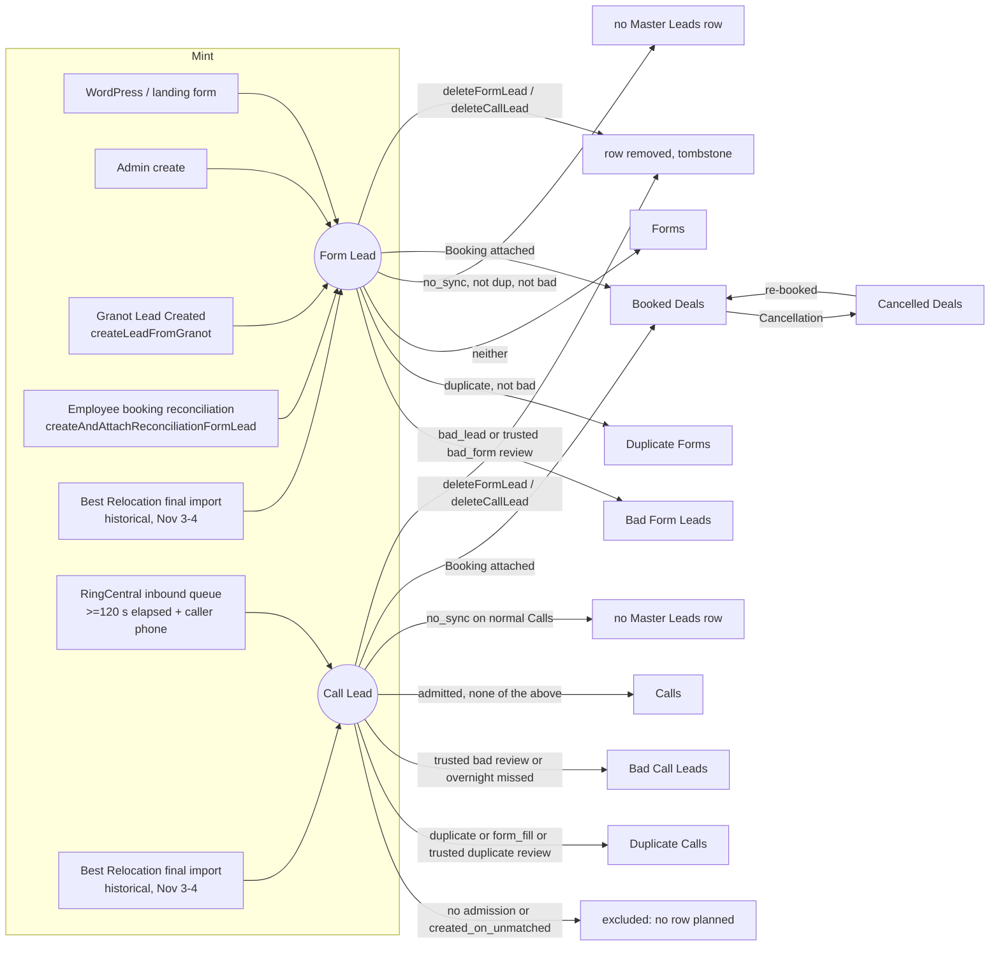

# Lead lifecycle

The Owner directed on November 20 that all logic for how Form Leads, duplicate Forms, Call Leads, duplicate Calls, bad Calls and bad Forms are minted and move through their lifecycle be documented completely and per the most recent code. This pack is that Reference. Every rule cites `file:function` and a line range at `main` = `9955430d`.

Code wins over older Service docs. Where code and a locked Owner directive disagree, the pack records a finding for the Owner and does not soften the rule. The findings are listed in [COVERAGE.md](COVERAGE.md#owner-directive-findings).

## How to use the pack

| Question | Read |
|---|---|
| How does a Form Lead get created, priced and deleted? | [form-leads.md](form-leads.md) |
| How does a Call Lead get created, and what may never create one? | [call-leads.md](call-leads.md) |
| Why is this Lead a Duplicate Lead or a Form Fill? | [duplicates-and-form-fill.md](duplicates-and-form-fill.md) |
| Why is this Lead on Bad Form Leads or Bad Call Leads? | [bad-leads.md](bad-leads.md) |
| What did Granot change on this Lead? | [granot-effects.md](granot-effects.md) |
| How did this Lead become booked or cancelled? | [bookings-and-cancellations.md](bookings-and-cancellations.md) |
| Which tab, billable value and CPL does this Lead get? | [reporting-and-sheets.md](reporting-and-sheets.md) |
| What does this state mean to the Desk, Pool, Daily Operations, Insights, Numbers or the Job timeline? | [downstream-consumers.md](downstream-consumers.md) |
| Is every entry point, command, field writer and routing reader covered? | [COVERAGE.md](COVERAGE.md) |

Glossary words come from the workspace [`CONTEXT.md`](../../../../CONTEXT.md). The pack does not redefine them.

## Locked Owner directives this pack enforces

1. **RingCentral-only Call minting and billing (2026-11-03).** Only RingCentral inbound queue qualification may create a Call Lead or make it eligible for Calls reporting and lead billing. Enrichment, a matching contact, a Granot job, booking status or an old sheet row never qualifies a Call. Manual, external-sheet and Granot `create_if_missing` Call creation are closed. Saved historical RingCentral qualification stays valid.
2. **Best Relocation exceptions (2026-11-03).** The closed 69-record historical Call inventory (`best-relocation-legacy-reporting-v1`) and the one-time final import admission (`best-relocation-final-import-v1`, 43 Calls, 272 exception Forms) are the only non-RingCentral admissions. No further import is authorized.
3. **Form/Call pair (2026-10-28) and sibling mirror (2026-10-29).** Link the pair, never store one job on two Leads as separate truths. A Granot update to a Form Lead mirrors job, priority and receiver onto the same customer's admitted Call Lead (`granot_form_sibling`). Booking intake prefers the Form Lead. Call Leads are still created only by the RingCentral queue.
4. **Form Fill (confirmed November 20).** A qualified Call gets `form_fill: true` when a non-duplicate Form Lead has the same normalized phone under the same overarching Source Company (`lead_source_company`, else the legacy `source_company` slug), in either order and with no time window. It routes to Duplicate Calls, is not billable, and still receives Granot updates in place.
5. **Official Bookings and Cancellations stay reportable** without a Lead (Leadless Booking, Referral Booking).
6. **Master Leads Calls tab (November 20).** No backfill or major change on the Calls tab. The Owner handles removals and inspection there manually. Only RingCentral-queue-qualified Call Leads get minted and take part in the lifecycle. Pre-November-3 Calls and their rows are not removed retroactively; server reporting and billing still exclude Calls without admission, with no date cutoff.

## State model

Each Lead has one creation path and then a reporting disposition that is recomputed from its saved flags on every Sheet Sync delivery. The disposition is not stored.

Granot updates (job, priority, receiver, move date) change fields on a Lead in any state. They never mint a Call and never change a Call's tab by themselves. See [granot-effects.md](granot-effects.md).

## Reporting precedence summary

Source: `src/services/leads/callLeadReportingDisposition.ts:getCallLeadReportingDecision` L18–L39, `src/services/googleSheets/expectedSheetTabs.ts:planExpectedSheetTabs` L142–L204, `src/services/googleSheets/leadReportingTargets.ts:hasFormBadProjection` L25–L27, `src/services/sheetSync/noSyncLead.ts:noSyncAppliesToNormalTabs` L13–L34, all @ `9955430d`.

**Form Leads** (first match wins):

| # | Condition | Tab | Priced in Insights (live CPL) |
|---|---|---|---|
| 1 | `bad_lead` set, or trusted `external_sheet_review.kind = bad_form` | Bad Form Leads (exclusive, even when duplicate or booked) | yes when not duplicate (open Owner question) |
| 2 | `duplicate: true` | Duplicate Forms | no ($0, status `duplicate`) |
| 3 | `no_sync: true` | none (rows deleted from every Form tab) | yes |
| 4 | otherwise | Forms | yes |

There is no Form `excluded` disposition in code. The stamped `cpl` on a Form is the full rate even when it is a duplicate; readers apply the $0. Detail: [reporting-and-sheets.md](reporting-and-sheets.md#billable-value-and-the-cpl-used).

**Call Leads** (first match wins):

| # | Condition | Disposition and tab | Billable |
|---|---|---|---|
| 1 | No admission (`hasReportingEligibleCall` false), or `created_on_unmatched: true` | `excluded`: no tab planned, and existing rows are left in place | no |
| 2 | `duplicate: true` (90-day repeat), `form_fill: true`, or trusted duplicate review | `duplicate_calls`: Duplicate Calls | no |
| 3 | Trusted `bad_call` review, or confirmed final caller-side Missed result arriving in [01:00, 07:00) America/New_York (`overnight_missed_call`) | `bad_call_leads`: Bad Call Leads | no |
| 4 | otherwise | `calls`: Calls | yes |

**No-Sync on Calls.** `no_sync` never changes the disposition or billing. The Sheet planner checks it first: when `no_sync: true`, the Call is not `duplicate: true`, and the disposition is not `duplicate_calls` or `bad_call_leads`, it deletes the Call's rows from all three Call tabs and upserts nothing (`sheetSync/noSyncLead.ts:noSyncAppliesToNormalTabs` L28–L33, `jobPlanner.ts` L141–L171). That includes an excluded Call without `duplicate: true`, whose rows are otherwise left alone. An excluded Call with `duplicate: true` keeps its rows even with `no_sync`. No production Call has `no_sync: true` today. See [reporting-and-sheets.md](reporting-and-sheets.md#no-sync).

Duplicate takes precedence over bad for Calls, and the bad reason codes are kept. Bad takes precedence over duplicate for Forms. Admission is decided by `src/services/leads/callLeadAdmission.ts:hasReportingEligibleCall` L52–L62: saved RingCentral qualification, the closed Best Relocation historical inventory, or the trusted final-import admission.

Booked Leads always plan Booked Deals; Cancelled Leads always plan Cancelled Deals (`planExpectedSheetTabs` L178–L203).

## Production snapshot, November 20

Read-only, 13:50–13:51 New York, after the session's Owner-approved Form-tab fixes and test-fixture purge. Full reconciliation with every difference explained: [COVERAGE.md](COVERAGE.md#production-reconciliation).

| Lead type | Total | By disposition |
|---|---:|---|
| Form Leads | 9,045 | Forms 7,817 · Duplicate Forms 192 · Bad Form Leads 1,035 · no_sync 1 |
| Call Leads | 2,118 | Calls 1,457 · Duplicate Calls 430 · Bad Call Leads 19 · excluded 212 |
| Booked Leads | 1,072 | 930 linked to a Lead, 142 without a Lead |
| Cancelled Leads | 14 | 9 linked to a Lead, 5 without a Lead |

## Track A

Track A changes the scheduled Granot sibling catch-up and Record Link establishment. Sections marked "Pending re-verification against the Track A merge" describe `9955430d` and must be re-checked against the merged code.
