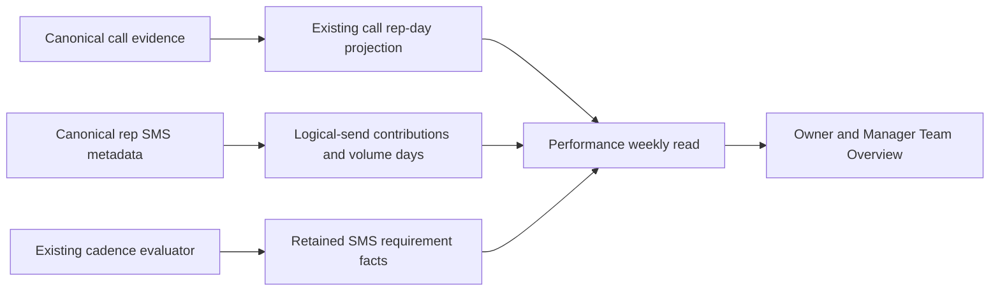

# Outreach performance: codebase exploration and architecture

Inspected October 16, 2026. These are local code findings and an implementation proposal, not production verification or a claim that the feature exists. Both repository remotes belong to `jbell-rusty-vantage` (`vantage-movers-server` and `vantage-admin`). No provider, MongoDB or production reads were needed.

## 1. What already exists

| Responsibility | Verified location | Reuse / limitation |
| --- | --- | --- |
| Desk business rules | [Service](../knowledge/services/sales-outreach-desk.md), [lifecycle](../knowledge/sales-outreach-lifecycle.md) | Current implementation takes precedence over obsolete launch assumptions. |
| Canonical call and SMS event derivation | `src/services/salesOutreach/contacts/derive.ts`, `engine/credit.ts`, `src/models/salesOutreach/contactEvents.ts` | Once-per-source events, temporal caller identity, all-outbound call credit and separate subject association already exist. |
| Daily call facts | `contacts/repDay.ts`, `src/models/salesOutreach/projections.ts` | Both all-outbound and eligible-New/Quoted counts are stored. Past goal snapshots freeze; coverage remains explicit. Do not count from paged queues. |
| Roster and goals | `roster/rule.ts`, `reads/goals.ts` | Reuse effective goal resolution, working dates and overrides. Historical Agent active/Desk flags lack complete temporal history; missing past rows cannot safely use today's membership. |
| Rep SMS source facts | `src/models/salesOutreach/repSmsEvidence.ts` | Metadata-only evidence with logical-message dedupe, reviewed sender, send time, failure corrections and source revision. No message bodies needed. |
| SMS requirements | `engine/types.ts`, `engine/evaluate.ts` | `EvaluateSubjectResult.obligations` exposes deterministic IDs, outcomes, deadlines, responsible Agent, fulfilling event and miss truth. |
| Stored subject projection | `evaluation/projection.ts`, `evaluation/store.ts` | Stores channel summaries and 30-date `window_history`, but not the full obligation result. History counts late fulfillment as completed and lacks per-obligation responsibility. Insufficient for this report. |
| Evaluator transaction | `evaluation/evaluateJob.ts` | `evaluateAndProject` runs inside the job completion transaction with configuration-version checking and projection CAS. This is the natural place to retain reporting facts. |
| Week semantics | `reads/businessDay.ts`, `reads/repMetrics.ts` (`repBinderWindows`) | Binder uses Monday-through-today based on New York dates. Reuse calendar helpers rather than financial calculation code. |
| Auth | `permissions.ts`, `src/routes/sales-outreach.routes.ts` | `team_reads` is Owner/Manager. Existing `rep-days` also admits Reps with scoping; do not expose team performance through that surface accidentally. |
| Team UI | Admin `components/outreach-desk/views/team-view.tsx` | Existing Daily call goals and attention sections provide the insertion point. |
| Client transport | Admin `lib/api/salesOutreach.ts`, `components/outreach-desk/data/use-desk-reads.ts`, `lib/query/salesOutreach.ts` | Extend typed reads and query keys. Server owns rates, statuses and ranks. |
| Proxy and freshness | Admin `server/auth/outreach-desk-routes.ts`, `components/outreach-desk/data/use-desk-live.ts` | Manager gets an exact GET allowlist entry; Rep gets none. Existing foreground polling, reconnect snapshots and midnight refresh can refresh this read. |

## 2. Gaps that must be addressed

### All-text volume is broader than existing cadence evidence

`classifySmsEvidence` returns `other/excluded/no_associated_subject` before assigning a sender when there is no associated subject. Ambiguous association also blocks cadence verification. Therefore counting only confirmed SMS contact events, or filtering them by `actor_agent_id`, undercounts the approved volume metric.

Build volume facts from the canonical rep-mailbox source metadata, with the existing logical-send winner, successful status and reviewed sender resolution. Volume must be independent of subject association. Preserve cadence eligibility exactly: do not change an excluded contact event to confirmed merely to make it count in a report. SMS `goal_agent_id` is null by design; do not repurpose the call-goal field.

Existing derivation treats reviewed rep-mailbox evidence as deliberate and treats `lead_messages` as automation. Reuse that origin basis. During implementation, verify that automated sends cannot also be credited through captured mailbox copies; where origin is unproven, keep it pending rather than guess that it was human-authored. This is an evidence proof, not permission to add a new provider workflow.

### Summary history cannot establish required-text completion

The engine exposes exactly the required grain, but projection persistence discards it. `windowHistory` combines `fulfilled` and `fulfilled_late` in `completed`, aggregates away responsibility, and slices to 30 dates. Summing those summaries is both semantically wrong and insufficient for historical week browsing.

Retain the existing engine's obligation results at evaluation time. Do not reconstruct historical obligations in Admin from present-day priority, assignment, or configuration. Do not create a second cadence evaluator.

### Historical completeness must be explicit

Past goal rows can be reused, but some days predate frozen roster rows. Agent membership history is incomplete. Provider activity has an existing retention path (`src/services/salesIntelligence/retentionPolicy.ts`); reports cannot assume source facts last forever. Reliable report start dates must be established by a read-only implementation-time inventory, separately for calls, SMS volume and SMS requirements. This design does not promise a complete retroactive report since Desk launch.

## 3. Recommended module and interface

Keep a single `src/services/salesOutreach/performance/` module. Its public read is conceptually `readTeamPerformance(actor, { week_start }, deps)`. It handles authorization, historical membership, dates, coverage, daily states, exact-fraction ranking and response composition. Internal writers accept canonical SMS source changes and engine obligation results. Routes validate and delegate; Admin only renders.

Proposed `GET /api/v1/admin/sales-outreach/performance?week_start=YYYY-MM-DD` requires `team_reads`, the existing signed actor/API-secret guards and production scope. Default to the current Monday; reject invalid, non-Monday and future-week inputs. Limit every request to one week. No provider calls, writes, backfills or index creation in GET.

Response shape, to finalize in Zod before UI implementation:

```text
week: start, end_exclusive, through, timezone
as_of, earliest_reliable_dates, channel_freshness, provisional
rows[]:
  agent_id, name, historical_membership_state
  calls: rank|null, weekly_volume, met_days, eligible_days,
         pending_days, completion_rate|null, provisional
  texts: rank|null, weekly_volume, on_time_required, resolved_due_required,
         pending_requirements, completion_rate|null, provisional
  days[7]: business_date, future, calls{actual, goal, state, coverage},
           texts{sent, on_time_required, resolved_due_required,
                 applicable_required, pending, state, coverage}
unassigned: required_text_counts
```

Separate weekly `resolved_due_required` from all applicable due work and pending counts so `18/20 required · 90% · 2 pending` cannot silently use a denominator of 22. Explain that 20 is resolved; today uses live applicable counts. Null means unavailable, zero means verified absence. Rank integers and rate numerators/denominators are computed once on the server.

## 4. Persistence: retain facts, compose weeks

Prefer reuse of existing call rep-day projections plus two narrow new reporting stores, rather than an independent duplicate set of call aggregates and stored weekly leaderboards.

1. **`sales_outreach_sms_volume_days`**, unique `{agent_id, business_date}`: confirmed logical-send count, pending count, mailbox/derivation coverage and reliable interval, source fingerprint, computed timestamp and revision. It is independent of subject matching. Keep stable logical-send contribution provenance (canonical logical ID, credited Agent/day, revision and counted/pending/excluded disposition) so a sender/date/status correction removes the old contribution and adds the new one exactly once. Recommended companion store `sales_outreach_sms_volume_contributions`, unique canonical logical ID, contains only those compact contribution facts, no content.
2. **`sales_outreach_sms_requirement_facts`**, unique `{subject_id, obligation_id}`: period, business date/deadline, responsible Agent, engine outcome, deadline-missed truth, fulfilling event/time, exemption disposition, coverage state, policy/engine/input versions, fingerprint and revision. This is a projection of requirements the engine already produced, not a new task or goal. Index Agent/date and subject/period for recount/replacement. Facts survive queue projection truncation.

Preserve historical daily call rows. Add only reporting closure/coverage metadata if the existing row is insufficient; do not fork call goal resolution. During retained-source recount, a range outside source coverage must never overwrite preserved confirmed facts with zero.

The requirement writer must reconcile a subject's authoritative evaluation range, including invalidated/disappearing slots: upserting only returned obligations would leave superseded requirements counted forever. Tombstone/remove eligibility only inside the complete proven range, preserve genuine old misses, and leave older unaffected facts intact. Changes moving responsibility/date invalidate both old and new report keys.

Weekly reads aggregate seven daily call rows, SMS volume rows and indexed SMS requirement facts. The team is small enough to avoid a separately persisted weekly rank. If measurement shows requirement aggregation is slow, materialize rep-day requirement counts from these same facts; keep one source of truth and one calculation. Use exact fraction comparison for ordering.

New models use the existing `defineCsiModel`, explicit index registry/build scripts, `autoIndex: false`, UTC instants and New York business-date conventions. Keep references and counts compact. No new environment variables or goal configuration namespace is required. A later retention choice must account for correction provenance; do not attach the source activity TTL automatically to report history.

## 5. Update and correction flow



- Extend the existing SMS source-change processing, including reviewed-identity remap and mailbox-copy winner changes, to recount the old and new Agent/date volume contributions. A failed status revokes earlier credit.
- Retain SMS obligation results inside the existing evaluation transaction, with the same revision/configuration fences. Reporting writes must be considered even when the queue projection does not change: newly introduced facts need initial materialization on a semantic no-op evaluation. Missing-reporting-facts reconciliation must not rely exclusively on future Lead activity.
- Preserve closed subjects and past policy periods in report backfill/correction scope. The engine's quiet/closed behavior and bounded input loaders must not silently omit them. A capped/incomplete input is pending, not a complete historical range.
- Use deterministic contribution identities, transaction/CAS and input fingerprints. Replay or concurrent work adds no extra count. Never acknowledge a source change before report writes or a durable retry nomination commits.
- Coverage advancement, workday close and New York rollover must resolve pending reports even without new messages. Reuse existing scheduled worker admission and durable job mechanisms; explicitly register any new stage if needed, rather than bypassing the retained-stage fence. Do not introduce a second polling/provider lane.
- Reuse `outreach_goal` / `outreach_desk` committed invalidation hints for performance refetch where sufficient, including SMS-volume-only changes that affect no subject. Keep team rows out of Rep payloads. Foreground polling and reconnect snapshots recover lost hints; historical corrected weeks must invalidate as well as the current week.

## 6. Admin integration

Implement `components/outreach-desk/views/rep-performance.tsx` and render it in `team-view.tsx` after Daily call goals. Add response validation in `lib/api/salesOutreach.ts`, one query key per week, a read hook and report-specific week/channel state. The full weekly response contains both channels and seven dates, so expanding a rep needs no extra fetch and switching tabs cannot produce mismatched ranking inputs.

Add the exact Manager GET proxy permission in `server/auth/outreach-desk-routes.ts`. Do not add it to `REP_OUTREACH_ROUTES` (the Manager list spreads that Rep list). Preserve the route-scoped Desk design tokens, accessibility and refresh behavior. Keep queue filters independent. Do not reuse an Owner-only Numbers endpoint to give Manager access to this report.

## 7. Delivery sequence and verification

1. Freeze the specification examples as calculation fixtures. Demonstrate report-close timing against existing goal scheduling without policy changes. Inventory retained input ranges and historical membership gaps read-only; record the reliable range per channel.
2. Implement the reporting module and DTO, logical SMS contribution accounting and engine-fact persistence. Add explicit indexes through the normal script. Prove replay, status reversal, reassignment, helper attribution, obsolete-slot removal and no-op evaluator materialization.
3. Implement bounded report/apply/verify backfill commands against a named database, never GET. Report-only mode writes nothing; backfill only provable ranges with stable checkpoints. Include closed subjects, historical members and zero-activity roster days only where supported.
4. Implement the guarded weekly read and Admin block using synthetic fixtures. Cover exact fractions/ties, zero vs unknown, weighted SMS rates, current-day exclusion, off-days, Sunday/Monday and DST. Verify Rep/direct-route/BFF refusals.
5. Verify the integrated Owner and Manager view on desktop and narrow screens. Confirm rows reconcile to source samples, history beyond 30 dates survives, a deactivated rep remains in a prior week, data errors are readable, and refresh preserves expansion/focus.
6. Release server/report writers and indexes before Admin consumption. Preserve reporting facts during rollback; hide the added block or remove the added read while keeping existing Desk behavior. Existing packet deployment permissions are not broadened by this design task.

Required correctness checks are through the reporting interface and integration with canonical evidence/engine output, not tests that reproduce a second implementation of cadence. Benchmark one historical and one current-week read at representative retained volume before choosing extra materialization. This turn performed documentation review only; none of these implementation tests or backfills has run.

## 8. Remaining implementation proofs

No further Owner policy question is required for this first specification. The implementer must still prove source-origin exclusion, deadline responsibility on fulfilled requirements, historical input/policy availability, closure/coverage reconciliation, retention-safe corrections and index/query performance. If retained facts cannot prove a date, expose that limitation; do not fill the gap with a policy assumption.
